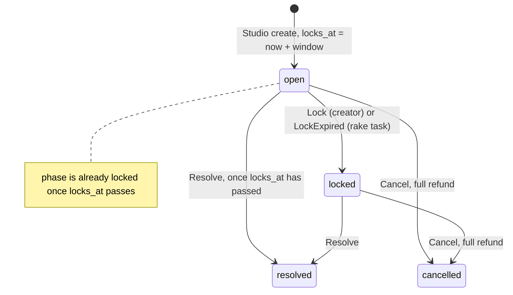

## Summary
Write `docs/architecture.md` so every teammate (and their AI assistant) can change the betting engine without re-deriving how credits move, and so the final demo has a clear technical story. Today it lives in code comments and one README paragraph.

## Context
- Math: [`parimutuel.rb`](https://github.com/YaroslavPetrashko/tolchu/blob/main/app/models/parimutuel.rb) and [`parimutuel/settlement.rb`](https://github.com/YaroslavPetrashko/tolchu/blob/main/app/models/parimutuel/settlement.rb). Credits: [`Wallet`](https://github.com/YaroslavPetrashko/tolchu/blob/main/app/models/wallet.rb), [`LedgerEntry`](https://github.com/YaroslavPetrashko/tolchu/blob/main/app/models/ledger_entry.rb). Lifecycle: [`Market`](https://github.com/YaroslavPetrashko/tolchu/blob/main/app/models/market.rb) ("the clock is the source of truth for the lock") and [`app/services`](https://github.com/YaroslavPetrashko/tolchu/tree/main/app/services). Constraints: [`db/schema.rb`](https://github.com/YaroslavPetrashko/tolchu/blob/main/db/schema.rb).
- README's "How it's built" states the invariants in one sentence, without diagrams.

## Suggested implementation
Create `docs/architecture.md` (new; GitHub renders Mermaid) with:
1. **Data model:** an `erDiagram` of users, sessions, markets, outcomes, bets, ledger_entries with key columns. Show both market–outcome links (`outcomes.market_id`, `markets.winning_outcome_id`), `markets.creator_id`, the unique `bets (user_id, market_id)`, and the optional `market_id`/`bet_id` on ledger entries. List the cached columns and their sources: `users.balance`, `outcomes.pool`, `markets.total_pool`, `markets.bets_count`.
2. **Lifecycle:** a `stateDiagram-v2` showing that the clock closes betting before the status column changes. Keep `::` and `;` out of Mermaid labels and name the services in the text:

3. **Parimutuel math:** formulas plus the example from [`features/betting/payouts.feature`](https://github.com/YaroslavPetrashko/tolchu/blob/main/features/betting/payouts.feature). Alice 100 and Bob 50 on Swish, Carol 50 on Brick: pool 200; rake min(floor(5% of 200), 50) = 10; distributable 190; Alice floor(190 × 100 / 150) = 126, Bob 63; dust 1; contest score 1/2; creator floor(10 × 1/2 × 1/2) = 2; house 10 + 1 − 2 = 9; and 126 + 63 + 2 + 9 = 200. Also cover the no-contest refund and the rake cap.
4. **Invariants and the specs that enforce them:** balance equals the ledger sum ([`wallet_spec.rb`](https://github.com/YaroslavPetrashko/tolchu/blob/main/spec/models/wallet_spec.rb)); payouts + `creator_reward` + `house_take` == pool, and winners never get back less than their stake ([`settlement_spec.rb`](https://github.com/YaroslavPetrashko/tolchu/blob/main/spec/models/parimutuel/settlement_spec.rb) "invariants across random pools", [`resolve_spec.rb`](https://github.com/YaroslavPetrashko/tolchu/blob/main/spec/services/markets/resolve_spec.rb)); a market settles once (`resolve_spec.rb`, `cancel_spec.rb`); one bet per user per market and no bet at or after `locks_at` (`bet_spec.rb`, `place_bet_spec.rb`). Name the DB constraint behind each, where one exists.
5. **Locking strategy:** market row first in every service, user rows through `Wallet#post!`, users locked in id order during settlement (no deadlocks), pools via `update_counters`, the unique index as the last guard against double bets.
6. **Where new code goes:** pure math in `app/models/parimutuel*`; anything that moves credits or changes market state is a service returning `ApplicationService::Result`; credits only through `Wallet`; models hold validations, scopes, predicates, and query objects (`MarketFeed`); thin controllers answering with Turbo Streams plus HTML; Stimulus for JS.
7. **Testing strategy:** RSpec layers and helpers (`place_bet`, `sign_in_as`), Cucumber over rack_test (no JS driver until #12, Browser-level Cucumber scenarios for the clip player, countdown, and stake estimate), merged SimpleCov, `bin/ci`.

Link the doc from "How it's built" in [`README.md`](https://github.com/YaroslavPetrashko/tolchu/blob/main/README.md) and from "Before you push" in [`CONTRIBUTING.md`](https://github.com/YaroslavPetrashko/tolchu/blob/main/CONTRIBUTING.md).

## Acceptance criteria
- [ ] Both diagrams render on GitHub
- [ ] Every number in the example matches `payouts.feature` and `settlement_spec.rb`
- [ ] Each invariant links to at least one spec that enforces it
- [ ] Every class, method, and column named in the doc exists on `main`
- [ ] README and CONTRIBUTING link to the doc
- [ ] `bin/ci` passes

## Notes
- **Depends on:** nothing. Update the locking section when #28 (Concurrency specs for simultaneous bets and settlements) lands.
- **Out of scope:** API docs, deploy runbooks.
- **Size:** S
